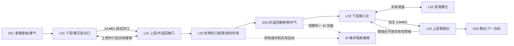
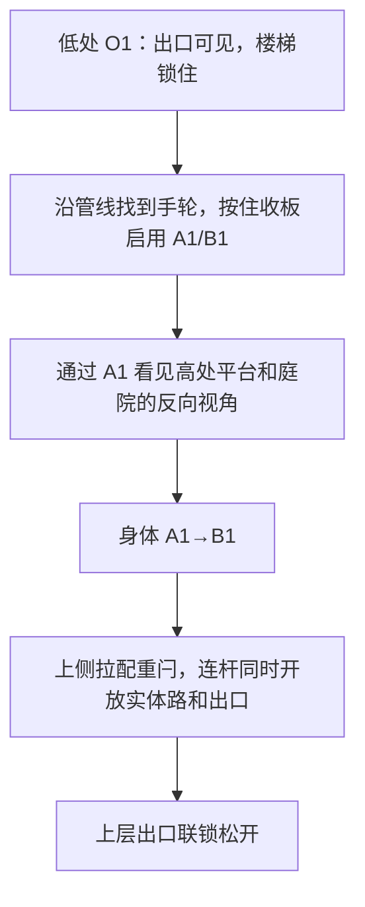
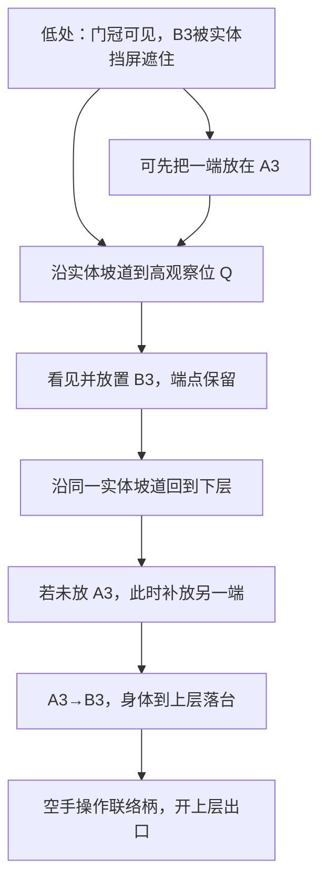

# 第一章《苏醒》：空间与谜题设计

M1-R3：用户已确认R2基础体验/声音/字幕通过试玩；本轮只在现有L01物理与谜题上制作[视觉样板](l01-r3-visuals.md)。旧版灰盒/声音数量与验收措辞作为历史；当前视觉复测以[R3交付](../m1-r3-review.md)为准。其余单元仍未制作。

M1-R2保留下列L01空间与机关，仅更新英语对白、双语字幕和最低演出；当前15句及语音数量以[R2记录](../m1-r2-review.md)为准。其余单元继续是未制作提案。

M0 详细设计提案 v0.1；**仅 C01-L01 已获 M1-R1 体验重构与随行/对白原型授权，新版仍待用户体验**。本章用三个核心谜题与三个互动序列建立“认识路径→借用路径→自己接驳路径”，并让第一次恢复操作产生可回访的后果。预估 18～26 分钟仅为整章设计预算，不能据此声称本轮时长。

下文 L01 对应 M1-R1；详细平面、状态和推演见 [重构设计](l01-r1-design.md)；S01、L02、S02、L03、S03、W 和整章拼接仍是 M0 提案，未制作。邻接表的 L01 行已反映 M1，其余单元保留提案坐标，不能当成已经接上的三维设施；后续获批时再协调 L01 新出口与 L02 入口，不在本轮机械修改相邻单元。本轮运行方法、证据和验证限制见 [M1-R1记录](../m1-r1-review.md)，旧[M1记录](../m1-c01-l01.md)保留为历史。

关联文档：[事件/广播/检查点](chapter-01-events.md)、[首次体验推演](chapter-01-walkthrough.md)、[技术边界](../technical/arkglide-api-audit.md)、[制作阶段](../production-and-acceptance.md)。

## 统一坐标、尺度与交互

- 米为设计单位；X 向东、Z 向北、Y 向上。下文点为世界坐标，玩家位置记**脚底**，物件/折口记中心。引擎实际胶囊中心、模型原点与脚底的换算须在获批灰盒中校验，不能直接混用。
- 暂定玩家高 1.8m、半径 0.3m、眼高 1.6m，步速 4m/s、jumpSpeed 4m/s、stepHeight 0.25m、重力约 9.8m/s²，首人称 FOV 75°。这些是待验证配置，不是运行测量；本章不要求跳跃解谜。
- 主通路净宽至少 2.0m，重要回转/折口落脚区至少约 3×3m，门净高至少 2.4m。M0 栏杆初值约 1.1m；M1 L01 上层护栏采用 1.3m、楼梯实心侧板高出各踏步 1.35m。其他单元仍须单独验证。通风百叶、玻璃与护网是否阻挡射线/物体须明确，不用不可见空气墙。
- 完整通行折口 2.2×2.8m；检修折口 0.8×0.9m。均竖直、矩形、无缩放；箭头表示**正面法线**。固定门两端 +Y 均朝上。
- E：拿起/放下所指可搬物，空手时操作所指设备；设备作用距离初值 1.8m。拿放在 S01 先学。鼠标左右键只在 L03 取得工具后选择两个端点；WASD、Esc、R 含义稳定，支持重绑。
- 初章自主放置为**校准锚位模式**：每个有效锚框有一个标定中心，玩家选择端点与位置，预览后确认。游戏层把中心转换为 `place` 射线，并重新核查遮挡/目标，绝不穿过挡板直接激活；这不是引擎自带吸附 API。C02 再评估开放锚面内微调。
- 校准锚位避免初学者把门放得过高。后续放开微调必须验证落脚高度；不能让玩家以精准对齐代替本章空间推理。
- 第一章拟用一个连贯预制体组织六单元，实体连接保留，不为每个房间独立加载。旧服务折口只有在返回梯/实体路可用、无人/物半穿越时才安全交接。

## 总体布局与相邻关系

下图保留 M0 的整章功能关系，**不按字符比例，也不是本轮已存在场景**；表内仅 L01 行更新为 M1，具体本关边界与点位以 L01 小节为准。不同高度可以在平面上重叠。

```text
                         北 +Z
  z36  ┌──────── C01-L03 调度厅 ───────┬── C01-S03 眺台 Y=3 ──┐
       │ Q 高观察位   B3/上层联络厅    │              → C02闸  │
  z30  │ ╱坡道      6m以上横向隔离     └────────────────────────┘
       │ A3 下层接入位          ← C01-S02 回廊：2.4→0，折返    │
  z24  └───────────────────────────┐  回望卷闸/手摇气路          │
                                   └──────────────┬────────────┤
  z20      维护线背面、护网                        │ C01-L02   │
           ┌──── 同一维护卷闸 W ────┐              │ 备件间    │
  z14      │     C01-L01 巡检庭     │ 上层出口 →   │ A2  ⋯ B2  │
           │ A1           B1 Y=2.4│              │     匣/坞 │
           │   中部不可通行设备区  │              └───────────┘
  z6  ┌────┴────┐                 │
      │ C01-S01 │ → 下层入口       │ 返程楼梯（先从上侧开闩）
  z0  └─────────┴─────────────────┘
      x0       x8        x16      x24                x40 → 东
```

| 单元 | 主要范围 X / Z；地坪与净高 | 入口→出口 / 真实邻接 |
| --- | --- | --- |
| C01-S01 复压值守室 | X[0,8] Z[0,6]；地坪 0，净高 3.2 | 起点 (2,0,1.5) → (8,0,3)，东接 L01 下层 |
| C01-L01 侧向通行（M1 灰盒） | 主庭 X[8,24] Z[0,14.4]；下层0、东廊2.4，总高约7；东侧另有1.8m深结束门斗 | 独立出生 (9.5,0,3) → (24,2.4,13)；当前止于门斗，未接 L02，未制作 W |
| C01-L02 隔栏借物 | X[24,40] Z[8,24]；主/备件地坪 2.4，缆线层 0，总顶约 6.8 | (24,2.4,12) → (29,2.4,24)，北接 S02；西窗回看 L01 |
| C01-S02 卷闸背面 | X[16,32] Z[20,30]；入口 2.4，折返后 0，净高 ≥3 | (29,2.4,24) → (16,0,24)，西接 L03 下层；在下层看 W 背面 |
| C01-L03 回望接驳 | X[0,16] Z[20,36]；下层 0、观察台 2.4、联络台 3，顶约 7 | (16,0,24) → (16,3,31)，东接 S03；不是沿入口方向一直走 |
| C01-S03 候潮眺台 | X[16,26] Z[30,36]；地坪 3，净高约 3.5 | (16,3,31) → (26,3,33)，抵达 C02 真实接驳闸；M0 不建闸后场景 |

维护卷闸 W=(18,1.5,14.5)，关闭时约 3m 高，沿 +Y 收起。其维护湾地坪 0，约 X[14,20] Z[14.5,20]，前后固定护网阻止早期直接进入机械扫掠范围；能看见闸位、编号与修补痕迹。C05 从另一个真实维护入口抵达其内侧，不能改位置以方便剧情。



## C01-S01 复压值守室：操作先于解释

**价值/目标**：先建立普通拿放和“动作→设备反馈→通行”的语法。没有隐藏匹配规则，不另计为核心谜题。

| 点位 | 位置/几何 | 功能、入口可见性与路线理由 |
| --- | --- | --- |
| 出生/应急座 | (2,0,1.5)，朝 +Z 略偏东 | 开始即可看见浮动表针和东侧出口，不锁头演出 |
| 脱落滤盒 | 中心 (5.8,0.85,4.3)，约 0.35×0.2×0.3m、2kg | 占住通风柜操作口；轮廓/把手明确，先普通抓取 |
| 宽托盘 | (4.8,0.65,4.2)，约 1.0×0.7m | 接纳滤盒但不要求对准插槽；移到其他安全处同样认可 |
| 手摇通气轮 | (6.5,1.0,4.5)，柜前留 1.5m 深操作区 | 滤盒挪开后可操作；表针/出风片机械连动 |
| 出口 | (8,0,3)，净宽 2m | 未通气时安全扣可见，稳定后解锁；不是等台词开门 |

流程：观察表针/安全扣 → E 拿开滤盒、再 E 放下 → 空手 E 操作通气轮 → 风声、纸带、表针和安全扣改变 → 步入巡检庭。轮的动作约 1～2 秒为直接反馈，无长倒数；如果声音尚未解锁，纸带/表针照样表达状态。

替代/异常：滤盒不必放托盘；带着它离开可行，但不能在持物时同时操作手轮，需先放在安全面。丢进柜后仍能从宽检修口取回；若不可达，室内复位柄回收同一个滤盒，不生成副本。阀轮重复操作不反锁出口；存档恢复不重复播放开场。

叙事：座侧新鲜抢修水渍、沾潮手套和外侧活动设备表明是近期事故。最短广播只给现场目标：“值守席，先确认通气。岸侧联络尚未接通。”不解释整座站历史。

检查点：`CP01-entry` 为初始安全状态；走出后满足稳定条件写 `CP02-court`。风险是新手把 E 理解为一直按住，或以为托盘是精密拼图；提示用拿起/放下图形切换，测试要观察其是否真的掌握普通拿放。

## C01-L01 侧向通行：身体的目的地在侧面

**本节为 M1-R1 L01 当前实施坐标**。只构建独立巡检庭与浅出口门斗，不包含 S01 或 L02 的可玩/占位空间。测试入口直接提供移动、观察、E与已挂载栈雀；它不证明玩家已玩过 S01，也不提前提供抓取、自由放门或其他机制。

**独特发现**：高处出口的平面距离很近，但直接楼梯从上侧锁住；侧面折口展示高处平台与同一庭院的反向视角。真实穿门后，玩家在高处重新认出刚才所在的庭院。穿门改变到达关系，不改变角色大小；出门后由玩家自主转头看东侧出口，不自动转镜头。

**已知/新内容**：正式章节预期已学移动、E 与设备反馈；本轮以标明灰盒的独立入口提供这些基础操作。只新教固定折口的观察/身体通过。不给放门工具，不增加远程搬运。

### 布局、视线和交互

| 点位/结构 | 几何与坐标 | 为什么这样摆 |
| --- | --- | --- |
| 本轮边界 | 西墙内面 X=8、东墙内面 X=24、北墙内面 Z=14.4；东出口另有约 1.8m 深门斗 | 用真实墙/地坪封闭本关；不搭北部维护湾、S01 或 L02 |
| 首个站位 O1 | 脚 (9.5,0,3)，眼约 (9.5,1.6,3)；初生胶囊中心 Y=0.92，随后由原生物理落稳 | 初始视线朝高出口；出口深色背板中心 (23.86,5.25,13)，浅色顶条中心 (23.74,5.48,13)。初生的 2cm 安全余量不用于正常移动/穿越 |
| 下层可走带 | 西侧约 X[8,14.1]、设备南侧 Z<4.2；下层地坪 Y=0 | 可以先沿南侧看锁梯，再回转到侧面手柄；不强迫唯一移动轨迹 |
| 中部设备区 | 南壳 X[14.1,19.9] Z[4.3,8.2]，北壳同宽 Z[10.5,13.7]，高1.9m；中部检视槽可穿行 | 从整块屏障改为有实际检视用途的设备；保留门冠视线与直接登高障碍 |
| A1 源折口 | (11,1.4,10)，正面 -Z；2.2×2.8m | 西侧可接近，底部齐下层地坪；前方 X[9.5,12.5] Z[6.5,10] 留落脚区 |
| 遮板手轮 | (13.35,1.12,8)，面向西；支柱顶高0.88m；遮板沿Y收起 | 通过连续管线找到侧面控制，按住E收板，松手棘爪保持；实际到位才原生安装/启用折口 |
| 可选检视百叶 | (14.03,1,9.35)，向上2.1m；槽内门槛高0.12m | 玩家可真正进入设备横向检视槽、辨认上层落脚区下方；不作为结束条件 |
| B1 目标折口 | (24,3.8,10)，正面 -X；同尺寸，横向开口 Z[8.9,11.1] | 背板归入东外墙，避免挡住梯顶；出口朝西，底部齐 2.4m 地坪 |
| 上层平台 | X[20.25,24]、Z[8.0,14.2]，地坪 Y=2.4；西侧为总高1.3m的真实透空立柱/横梁护栏 | 支持 B1 全孔径与侧向移动；出门能看同一庭院，南端连续接梯顶 |
| 上层回望位 O3 | 代表脚位约 (20.8,2.4,12.2)，玩家自主走近西缘 | M1-R1改透空护栏，扩大正常站位的回望视野；新版截图与可辨性见R1记录，不沿用旧实心栏板结论。B1原生窗口也能观察来处 |
| 返回楼梯 | X[20.25,24]、Z[3.2,8.0]；15 级，每级高 0.16m、深 0.32m；底门 Z=2.75 | 原生胶囊逐级通行；西侧连续实心侧板高出踏步 1.35m，防止从中段侧跳绕门；东侧为外墙 |
| 上侧配重闩 | (21,3.45,10)，长柄/支柱/可见连杆，E射程1.8m | 一次释放同时抬起返梯隔离门和出口检修架；不要求强制下楼再爬回 |
| 上层出口 | 门口脚底 (24,2.4,13)，净口 Z[12,14]；门斗止于 X≈25.8 | 从起点可辨认，梯闩操作后出口门与返梯门真实升起；只通向本关结束门斗 |
| 出口对比标识 | 深色背板 0.1×0.72×2.2m；浅色顶条 0.12×0.12×1.74m、两侧条 0.12×0.5×0.1m，位于 Z=12.18/13.82、Y=5.23 | 全为无碰撞视觉标识；以构图对比辅助发现目标，不伪造可达路径 |

代表视线推理：O1 眼位 `(9.5,1.6,3)` 至出口约 `(24,4.8,13)` 的线在 X=14 时高度约 2.59m，高于主壳与饰条；这只是几何核查，不能替代实际第一人称画面可读性验证。不能为保留 M0 原坐标让高出口藏在设备后。

```text
                                   北 +Z
 14.4  ┌─────────────────────────────────────┐
       │      中部实体设备，高1.9m  │护│ 上层│ 出口→浅门斗
 13.0  │                           │栏│  ↑  │ Z[12,14]
 10.0  │   A1 ↑                    │  │闩← B1（东墙，朝西）
  8.0  │   手轮→  横向检视槽        │  ├─────┤ 梯顶 Y=2.4
       │                           │侧│ ↑梯 │
  4.2  │                           │板│ ↑段 │
  3.2  │                           └──┤ ↑   │ 梯脚
  2.75 │ O1 → 可选先看锁梯 ────────────┤ 门  │
  0.0  └─────────────────────────────────────┘
       X=8        14.1           19.9 20.25 24
```

图不按比例。A1 位于低层柜体南面；B1 归入东外墙，两门正面并非同朝向。主路线：O1 → 可选查看锁梯 → 西侧按住手轮（可选开百叶探入检视槽）→ A1 → B1 → 从上侧打开梯闩 → 自主转向出口门斗。开闩后允许沿实体楼梯返回 O1，或 B1→A1 反向穿越，不惩罚好奇。

### 谜题关系与解法



结束条件：玩家实际抵达上层并操作梯闩，返回梯门与上层出口门运动到位，真实胶囊进入东侧出口门斗的上层安全体积。当前门斗是测试结束边界，不加载 L02。看过视窗、按过手柄、只开闩或在下层靠近出口投影都不等于解开；胜利条件不要求特定 portal ID 或作者指定脚步顺序。

替代解法：先透过折口反复观察再通过；走出 B1 后从楼梯回到 A1 再过一次；允许这些巩固认识的行为。门的正反面必须在造型上可辨认，背面有实体护板，不能从背后误穿。

绕关/失败：仍须检查 0→2.4m 的直接攀跳、楼梯侧跳、沿护栏/接头上顶；本轮没有滤盒和抓取能力，不把未制作物件当成已验证。若能轻易完全绕过空间发现，先改通路/净高，不用隐藏胜利触发器否认合法抵达。设备旁低处可走回。R 通过原生初始快照恢复到 L01 安全入口，回溯遮板、门对、梯闩及完成状态；这是独立灰盒的重试入口，不声称已实现正式全章 `CP02/CP03` 持久存档。

引导：R1使用高对比门冠、连续实体管线、手轮及棘爪保持、真实遮板运动、透空护栏与连杆配重建立空间联系。栈雀短对白补充观察，不自动转头或透露解法。4个原创机械原型音效已接入，正式配音/音效仍需后续制作和试听。

环境叙事边界：本轮只验证“自己启用空间通路，再打开实体退路”的行为因果。W、维护线编号/补修电缆、完整广播与正式音效未制作；不能从本轮灰盒截图推断这些已存在。未来正式章节仍按 M0 以真实设施变化积累叙事证据，梯闩到位后播简短确认；R1增加11句数据驱动短对白/字幕与栈雀临时实体，实际WinTTS配音0/11待本地生成，不以字幕/配音时长推进。

风险/验证：首视角是否真看清目标；视窗与门口是否足够安全；近门画面与眼身异侧；梯闩是否像清楚的退路操作；改为朝西出门后，玩家是否能认出同一庭院并自主找到右后方出口。新版测试结果以 [M1-R1记录](../m1-r1-review.md) 为准；旧版测试仅见 [M1历史记录](../m1-c01-l01.md)；任何技术测试通过都不等于初见玩家已能描述“我从侧面到了上面”。

## C01-L02 隔栏借物：身体不能去的地方，手里的路径能去

**独特发现**：通过窄折口搬回物体；不能沿玻璃的直线把它吸过来。接通坞座也会改变远侧设施。

**已知/新内容**：普通拿放与固定折口已学；只新增跨门抓取，锁存坞用可见棘爪解释。没有自主放置、持续保持或时间压力。

### 点位与尺度

| 点位/结构 | 坐标/尺寸 | 玩法作用 |
| --- | --- | --- |
| 入口/安全选择柄 | (25,2.4,12) / 柄 (25.5,3.4,12.5) | 看见目标后把服务回路从 L01 交接给检修折口；旧实体梯已通，无半穿越才切换 |
| 取物站位 O2 | 脚 (28,2.4,14)，眼高约 4.0 | A2 在前方，转角后能看见匣子；有足够前后调整空间 |
| A2 检修折口 | (28,3.55,16)，正面 -Z；0.8×0.9m | 底 3.10、顶 4.00，身体不适配；前部落物托台和护边防卡 |
| B2 检修折口 | (36,3.55,19)，正面 +X；同尺寸 | 出口朝向远侧备件台，约 90° 转角，无法用世界直线代替真实路径 |
| 匣子 C | 中心 (37,3.55,19)，0.48×0.36×0.55m，暂定 8kg | 托架顶约 3.37；旋转后仍给窄口留余量；不与箱堆/关节相连 |
| 直接观察窗 | 约 X=32、Z[16,21]，透明玻璃带护框 | 可以绕看备件，但玻璃真实阻挡抓取射线/物体；有反光/边框避免看成无物 |
| 锁存坞 D | 中心约 (26.8,2.75,18.5)，接纳区约 0.85×0.75m | 出口、管线与坞座同区可读；宽口不是精密插销小游戏 |
| 出口 G2 | 约 (29,2.4,23)，净宽 2.4m | 坞座锁存后原生运动到位，再允许通过，北接回廊 |
| 回收/复位柄 | (27.5,3.4,21) | 必需物掉到不可恢复处可召回原匣至备件托架；保持唯一 ID，无刷匣漏洞 |
| 西侧回望窗 | X=24、Z[16,20] 的安全观察带 | 视线朝 W；供电时卷闸运动、线缆灯向实际去向变化 |

主层为宽 L 形作业面，通向出入口与坞座；下方缆线层通过固定格栅可见但不能跌入。备件隔间不只是矩形空房：架高物台、斜向观察窗和折口朝向共同决定取件路线。锁存完成后侧检修小门可解锁，方便取回误放物，但解题前不能从那里走进去拿匣。

### 空间与机关关系


预期解法：确认玻璃后的匣子 → 从 A2 看见另一视角 → E 选中实际穿门命中物 → 沿 B2→A2 路径拉回 → 转向宽作业面，E 放入 D → 松手并稳定约 0.3 秒 → 棘爪翻下，G2 开启，远侧 W 下行。

抓取初始参数候选：总最大路径约 5.5m、持物点约 1.4m，力/阻尼以实际 8kg 匣调试。O2→A2 约 2m、B2→匣约 1m，总约 3m，留出瞄准和移动余量；**这只是几何估算，未验证弹簧可通行**。

结束条件：`busCommissioned` 已锁存、G2 实际到开位、玩家穿过 G2。W 是独立有安全停障的机构，不允许用假定运动时长冒充已闭合；其姿态/阻挡会影响后续观察，而不应锁死本关出口。

### 非预期操作、提示与恢复

- 尝试走窄口：实体孔径会阻挡；框上检修尺度、窄托台形状说明只能送物，不以透明墙伪装可通行门。
- 直抓玻璃后的匣：射线命中玻璃，不启动抓取；玻璃接触声/准星遮挡轮廓是反馈，不以文字责备。
- 拉到口边卡住/转身：保持真实 path；转回或后退可整理。路径失效时释放，能看见落点；不能跨墙直拉。
- 丢回远侧/台下：仍可从 A2 取回；不易取回时操作回收柄，回到同一初始匣，不改变谜题成功条件。回收期间禁止重复请求，不能复制持物。
- 玩家尝试一直拿在 D 上：不锁存。D 的承托片、接触位置和松手图标表达需要静置；不让持续弹簧抖动决定成功。
- 锁存后把匣取走：G2 不重锁，D 的棘爪保持。此规则与 C02 后教的保持坞明确不同；不是悄悄自动作弊。
- 玩家回看 L01：返回梯仍可用，A1/B1 休眠不困人；重新选择服务对必须保持单对与清空穿越边界。
- 提示顺序：托架传来轻碰声/凸显把手 → A2 边框短暂机械应答 → 关系提示“有些通路只需要让物件通过”；只有主动求助才讲具体操作。

剧情/声音：近处棘爪、门电机与远处 W 的低频落闸声有先后，管线走向可追踪。广播按真实状态说“检修供电已接通。维护线进入空载隔离。”；是否已“归位”只在实际到位后播。玩家可以直接去出口，不强制站在窗边听完；S02 会再次给物理证据。

检查点 `CP03-parts` 可从本关起点重试；完成且稳定后 `CP04-after-power` 保存真实卷闸状态与已播旗标。风险：窄口/力预算容错、玻璃误读、D 精细对位、同时运动造成注意力竞争；依次做原生边界验证与初见观察，不能只检查信号为 true。

## C01-S02 卷闸背面：把报告与现场对起来

**价值**：不增加新主机制，使用已学局部操作打开观察机会；从相反方向看到自己恢复操作的实际后果。主线结论是“这里被隔离了”，有人仍在只是逐渐形成的怀疑。

| 点位/结构 | 位置/路线 | 交互与信息 |
| --- | --- | --- |
| 上层接入 | (29,2.4,24)，向北到约 (29,2.4,27) | 从 G2 沿可辨认实线进入，不因配音强迫停步 |
| 横向缓坡 | 约 (29,2.4,27)→(17,0,27)，宽 2.4m，坡度约 1:5 | 12m 水平过程逐渐打开卷闸背侧视野，途中有可开检视百叶；走区止于约 Z=28.2，不侵入 Z≥30 的眺台楼板/净高 |
| 检视百叶/观察凹位 | 柄约 (18,1.0,23)，站位约 (18,0,22) | E 打开遮挡，再看 W 北侧；闸编号/同一电缆与 L01 对得上 |
| 手摇补气旁路 | 约 (20,1.0,23.5)，有近旁压力片/风条 | 可选 E 操作，局部风条和维护小灯恢复；产生 `airBypassOpened`，不解锁结局资格 |
| 权限拨柄 | 约 (16.8,1.0,24.5) | 手工登记检修接驳需求，能观察其机械线解锁 L03 工具柜；未要求阅读终端 |
| 下层出口 | (16,0,24) | 西入 L03，可回头；旁路操作非必需，不用隐藏门惩罚略过探索 |

主要路线：下坡→打开百叶观察隔离回路→拨权限柄→进入 L03。可选路线：在观察凹位听到短敲击/看到灯闪后手摇补气，再回主路线。百叶为宽活动片，不是只能从一像素角度窥视的藏线索口。

必要信息在静音下仍成立：实际闸位、机械隔离臂和线路状态；敲击可配局部振动/字幕“远处金属轻敲”，但不宣布“有人被你关住”。声音不自动跨折口传播，声源放在真实相邻工廊。

如果 L02 未注意到运动，本段用两个不依赖广播的状态对照补足：检视窗旁未熄的本侧电缆灯，与闸后已暗的维护灯；旁路手轮转动可以改变其中一项。不是路过就播放一段解释真相的独白。

结束条件：检视百叶打开、权限柄登记到位、玩家进入 L03。可以只按过百叶而未真正看过，程序不使用强制锁头来伪造理解；真实是否理解须在试玩中记录。`CP05-dispatch` 在进入 L03 并安全取得工具后建立。

恢复：坡道全程有护栏和返程路，旁路锁存后可回访；R 恢复检查点中的真实状态，已确认旗标不因穿过触发区反复广播。风险是玩家把补气当强制大谜题，或把远声理解为装饰；用小尺度清晰变化和后续兑现验证其价值，不增加文本。

## C01-L03 回望接驳：把观察位与出发位分开

**独特发现**：我能在高处确定远端，把端点留下，再从低处另一个位置出发。两端不需要在同一视野中完成；道路由我连接，不随离开视线消失。

**已知/新内容**：身体穿越、物体路径、锁存都已学；只新教接驳器的两端放置/保留。没有动量、计时、反射、货流或要同时按下的新组合。

### 平面和剖面关系

```text
  北 z36 ┌───────────────────────────────────────┐
         │ 西侧坡道/实心平台     B3（墙 z33，向南）│
    z33  │╱─── Q 观察台 Y2.4 ─┐   上层落台 Y3   │→S03
    z30  │    X2..5           │ ← gap ≥6m →     │
    z28  │      设备挡屏（南缘高3.8m）             │
         │                                       │
    z24  │ A3 墙x3，向东 →       下层入口(16,0,24)│
    z20  └───────────────────────────────────────┘

  剖面（关系示意）
  顶约7m          可见门冠灯约5.9m
                   B3中心4.4m
           Q眼高4.0m ────────── 观察锚面
  挡屏顶3.8m ───┐          ┌── 上层地坪3m/实心落台
  Q地坪2.4m ────┘    间隔  │
  下层眼高1.6m → 挡住 B3   │
  地坪0m ─ A3 ──── 下层可走与返回坡道 ──────────
```

| 点位/结构 | 坐标/尺寸 | 空间约束与可读性 |
| --- | --- | --- |
| 入口 O3 | (15,0,24)，先看北侧高处门冠，再向西看接入位 | 门冠/实物线使目标先出现，B3 本身不在入口直接可放视线内 |
| 工具柜 | (14,1.0,24.5)，旁有宽持物托台 | 权限柄解锁后 E 取接驳器；旧对安全交接完成才启用新端点 |
| A3 下层锚位 | 中心 (3,1.4,24)，正面 +X | 底齐下层；宽锚框约 3.2×3.4m，X 方向前留 ≥3m 安全区 |
| 西侧坡道 | 约 (1.5,0,20)→(1.5,2.4,32)，宽 2m，1:5 | 有明显上行线和检视口；尽端连到观察台，不是奖励性死胡同 |
| Q 观察台 | X[2,5] Z[28,33]，地坪 2.4；推荐站位 (4,2.4,30) | 与 B3 落台横向至少 6m 分隔；实心台+栏杆，能停下观察，不要求跳跃 |
| 设备挡屏 | 南缘约 Z=28、X[5,16]，不透明高 3.8m；后侧设备封闭下部通路 | 遮挡低处到锚面的视线，不遮门冠；西侧坡道观察口给出新的视线，不用隐形门禁 |
| B3 上层锚位 | (13,4.4,33)，正面 -Z；尺寸同 A3 | 底齐 3m；落台 X[11,16] Z[29.5,33]，出口向南有 ≥3m 深安全承托 |
| 联络柄 T | 约 (14,4.0,30.5) | 身体抵达才可手动接通；完成靠实际操作，不仅进入胜利区域 |
| 实体返回检修梯舱 | 约 X[11.5,13.5] Z[23.5,29.5]，下层 0→上层 3 | 预先建好的封闭梯舱，上侧接落台，下门由 T 解闩；外壳/下门在解题前不提供看穿 B3 的漏洞。下层从舱南侧 Z<23.5 绕向 A3 |
| 上层出口/门冠 | 地坪出口 (16,3,31)；门冠标记约 (15,5.9,31) | 出口与起点横向相邻但不同高度，经上层实路进入眺台 |

设计计算示例：从 O3 眼 (15,1.6,24) 到 B3 中心，在 Z=28 处视线约高 2.84m，低于 3.8m 挡屏；到 5.9m 门冠同处约高 4.06m，可以越过挡屏。Q 在挡屏北/高侧可看 B3。**这只检查两个代表性点的关系，未证明所有低处位置都不可放门，仍须实际遍历视线。**

挡屏背侧低处为设备基座/固定护罩，不可让玩家从无防护下层绕过去直接瞄 B3。坡道较高段出现等价有效视角可作为合理替代 Q，不强制站某个脚印。锚位中心命中必须通过真实遮挡核查，隔屏射击不能绕关。

### 谜题关系与解法



预期路线：取工具→在 A3 留一端→爬坡到 Q，看见远端锚面→放另一端→从实体坡道返回→A3→B3→联络柄→眺台。**B3 先放、回低处再放 A3 同样正确**；不把玩家记住正确按钮顺序当谜题。

规范路线通过已链接折口到达上层。实际结束条件：玩家抵达上层，联络柄到位、出口和返回检修梯下门实际解锁，再进入眺台。若有合法非预期路线抵达上层，应记录为替代解/布局风险，不能只因没有触发指定路线而假装未到达。

可接受替代：两端身份交换；从坡道等价高视角放 B3；先只侦察再按任意顺序放置；放错端点后重配回到正确关系。无任何操作会耗尽弹药或永久毁坏锚面。

绕关风险：从 Q 跳到上层（至少约 6m 横距，普通跳跃估算不足但未实测）；带入滤盒/接驳匣垫脚；沿挡屏顶攀行；低角度看到 B3 边角后绕过观察路线。先用实际胶囊/惯性/物件与全走区射线检查；若绕关仍产生有价值认识可接纳，否则改跨度/护罩和观察口，而不是加空气墙。

失败/重试：错误放置保留旧端点并给框形/机械短声；对同一锚位重放另一端若重叠，按引擎拒绝并提示已有端点。半穿越时重配先阻止并请求回到实心地面，不能把玩家挤落。下方均为有返回坡道的安全实体面；上层即使重配失去旧折口，仍可操作 T 解锁返回检修梯，而非必须重开关卡。越界才回 `CP05-dispatch`。

视觉与音效：A3 是可见近端、坡道检视口朝向高处、B3 标定纹理仅在高观察角可读；同一远侧门冠在返回时始终提供方向。广播不说“先放左门再上楼”，只在联络柄完成后报告岸侧接收端仍需实际接驳。

环境叙事：联络台的供电去向与 W 的隔离支线并列，玩家能用已学经验认出“恢复”有对象。对主线灯亮/低线暗的对照不作长独白解释。风险是高处看完不愿回头、把坡道当装饰、以为只能同屏放两端；盲测应分别记录首次目标识别与端点持久性顿悟，不能以成功脚本代替。

## C01-S03 候潮眺台：下一目标来自设施，不来自字幕

| 点位/结构 | 位置/比例 | 互动与叙事 |
| --- | --- | --- |
| 入台 | (16,3,31)，栏杆围合，台深约 6m | 从高处能看见主线装载区和更低维护灯；通过高差换节奏 |
| 机械去向指示柄 | 约 (20,4.0,33)，前留 2m 站位 | E 调开机械指示罩，显示岸侧接收臂尚未锁定、实体线路向下一闸延伸 |
| 回望位 | 约 (18,3,31) | 可经真实开口回看巡检庭/维护线方向；不强制镜头移动 |
| 下一闸 | (26,3,33)，净宽至少 2m | 联络已通且指示柄到位后安全松闩；闸后是 C02 备件层，不在本轮实现 |

路线：步入台→沿可走台边观察主/维护两线差异→操作去向柄→向备件层出发。必要短广播：“岸侧接收臂未锁定。请从备件层接驳。”可在行走中播，不等音频结束才放行。

独特价值是让玩家把“联络已通”和“物资真能到达”区分开，并亲手确认下一行动方向；不是站住听章节回顾。未回看者也有去向柄和机械线路的明确信息。

结束条件：联络接通、去向柄到位、出口闸到位，玩家跨越章末安全阈值。未来可写 `CP06-chapter-exit` 后交接下一章；M0 不制作加载器或 C02 占位。R 只回上个有效检查点，不把玩家生成在未加载区域。

风险/验证：展开视野是否造成迷路；是否误以为低灯区是马上可跳下的主目标；广播漏听后是否还能找到下一闸；高台无坠落软锁。以真实行走/静音初见验证，不以自动相机动画代替。

## 设计完成条件与尚未验证事项

文档给出了相邻关系、尺度、代表点位、玩家路线、三谜题的关系图、完整预期/替代行为、因果反馈和恢复策略；具体状态与播报在配套事件文档中定义。

仍未验证：真实视窗画面、胶囊/眼高换算、窄口抓取、所有跳跃/攀爬路线、目标初见可读性、实际解题时间、叙事推断和舒适度。设计推演不取消这些风险；只有用户批准后才能为**单个单元**开始相应灰盒验证。
