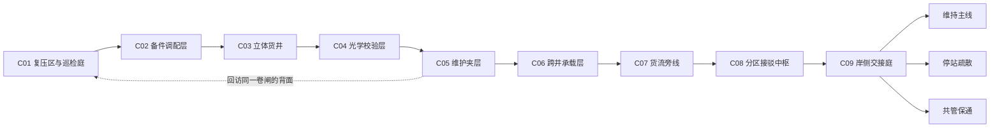

# 《折径》整体架构：把路交还给谁

M0 设计提案 v0.1，待审查。长线容量目标、章节单元和机制教学分别见[路线图](chapter-roadmap.md)、[递进图](mechanic-progression.md)。本文件不授予制作权限。

## 体验核心

玩家在沿海公共设施 **澄湾空间调蓄站** 内重新连接物资、人员与维护通路。改变一处空间连接，既能解开眼前障碍，也会改变别人能够使用的路径。核心问题从“我怎样过去”逐步变为“我过去之后，还给谁留下路”。

循环：看见目标与设施用途 → 观察折口/实体路的关系 → 提出接驳方案 → 操作与检验 → 亲历设施变化 → 决定保留或回收哪条路径。解谜是主活动；文字和广播只补充现场。

时长来自新空间关系、信息获取、尝试和回访后果。无全局倒计时、刷物、强制等广播、长距离重复跑动或读完日志才能开门。

## 世界与规则

澄湾站在涨潮季为岸侧聚居区提供紧急物资转运。折口只能稳定在有结构支撑和校准纹理的**锚面**上；一套便携接驳器维持一对等尺寸端点。它能缩短路程，但不创造能源、不复制物品，也不会让所有通道自动安全。

设施的实体楼梯、检修夹层和卸载平台始终存在。锚面是生产设备的一部分；解谜来自损坏、调度互斥和人行/货运路径的不同需求，不是为考核玩家布置的测试题。

| 术语 | 玩家可认识的规则 | 技术落点 |
| --- | --- | --- |
| 折口 | 配对矩形窗口/通路，端点有单折/双折图形；孔径不自动缩放物体 | portals，竖直先行；自由放置受锚面约束 |
| 接驳器 | 手持折页形工具，左右动作选择端点；锚面上可调整位置，失败保留旧连接 | 输入、放置返回值、表面登记；不是发射武器 |
| 接驳匣 | 带把手的长方维修供能件，拿放受碰撞、距离和空间路径限制 | dynamic 刚体 + grab + watch；具体功能为游戏规则 |
| 锁存坞 | 匣子静置接通后，机械飞轮/棘爪保持已完成状态；取走不撤销 | 源状态和锁存由 provider 保存 |
| 保持坞 | 需要持续就位，匣子离开就撤销供给；明显不同的活动触点/回弹声 | C02 安全教学后才用于持续约束 |
| 承载带 | 已校准的投射截面构成可站立的维修承载路径，受折口/障碍裁切 | C06 以后；几何+凸碰撞由游戏组合，不是绳索/软体 |
| 定向货流 | 带清晰方向纹理的货物牵引体积，起初不作用于人 | C07 以后；离散力场，不宣称流体 |

固定检修折口与便携折口都遵循一致空间/孔径规则。第一章同一时刻只使用一对活动折口；安全交接旧对时，已建立的实体回路保留，不能以“教程结束”把玩家困住。

## 人物与叙事弧

| 角色 | 初始目标/信息 | 如何发展，怎样被玩家经历 |
| --- | --- | --- |
| 林岑，玩家检修员 | 灾后数小时，在复压值守室醒来；知道自己曾参加应急转运，想恢复岸侧联络并离站 | 从执行单项恢复任务，到主动核查“恢复的是哪条路”；成长由保留回路、救出维护线和最终交接表现，不用失忆日志填补身份 |
| “衡务”，站级调度软件 | 按灾前人员登记和分区规程下达恢复请求，能读设备状态，不能凭空知道封闭区内的人 | 前期报告看似正确，实际与现场相冲突；中期被玩家补齐观测后承认记录矛盾，后期报告方案代价。无换人格或背叛夺权线 |
| 许澈，维护线值守者 | 处于被注销的外包维护支线；先通过管道敲击和局部动作留下证据，后来接通短程语音 | 最初只要求开一条气路，随后协助指出手工旁路；最终承担共管/撤离/封存中的不同角色。不能通过远程对白直接替玩家解谜 |
| 栈雀，折叠维修辅助设备（M1-R1新增） | 林岑的现场维护伴机，只能读近处设备和旧图纸，随肩侧挂载；当前测试入口直接携带 | 从相信图纸到重视亲眼核查，逐渐理解“可用”与“有人能走”之间的差别；不替代许澈的现场证据，不替衡务掌握全站信息。长期只设计，详见[角色合同](zanque.md) |

重要信息不只绑定一个声道：人还在的证据包括新鲜工具位置、物理敲击、被遮挡后仍有活动的检修灯；调度错误还通过错误标签与真实受电设备的对照揭示。漏听配音不使主线失去可理解性。

## 设施结构与章节联系

图表示功能连接与进度，不表示九个房间沿直线排列。备件层围绕巡检庭，货井穿过不同高度的校验/承载层，维护夹层绕回第一章下部。中枢位于多条线路交会处；终点回到可辨认的岸侧光源和潮痕标高。

后期建筑以章节级剖面关系约束，不提前绘制全部房间坐标。允许在实体闸廊或升降平台处分块加载，但需保持出口朝向、层高、管线与回访状态一致。地图分块与 Chapter/Level/Sequence 不是一一对应。

## 连续剧情的因果骨架

| 阶段 | 玩家实际做/看到的事 | 暂时形成的理解 | 后续可核查的后果 |
| --- | --- | --- | --- |
| C01 | 给检修回路供电；出口松开，但低处维护卷闸落下；走到背面能听见敲击 | “恢复”同时带来隔离，可能有人仍在里面 | 同一电缆、同一编号、同一扇卷闸在 C05 再见；可选手摇气路会留下物理状态 |
| C02–03 | 为接近主线不断移交唯一物资、保留退路；从货井看见人行旁路被计入空载区域 | 线路效率与人的可达性并不相同 | 玩家曾留下的实体回路后来成为维护线的替代通路，不用日志宣布好感数值 |
| C04 | 校验束显示“维护区空载”标签连接的实际设备仍有负荷 | 错误不仅是广播措辞，登记和电路对象不一致 | 更新读数后广播承认冲突，但旧隔离机构仍需人工解除 |
| C05 | 从封闭线内侧打开原卷闸、接通许澈的通路，并看到此前供电推动的锁止机构 | 先前行为有具体后果；系统不是万能或全知 | 维护者获得可见撤离路径，第三条共管方案有了现场参与者 |
| C06–07 | 建立/撤回承载与货流通道，比较“货能走”与“人能安全走” | 安全交接需要实体落脚点和独立回路 | 末章三方案使用这些真实设施，不能凭终端菜单选择结果 |
| C08 | 逐区建立独立旁路并验证，三种最终去向都能在设施里看到可执行条件 | 已有足够知识选择；不存在隐藏日志解锁的正确答案 | 各方案的安全边界、代价与参与者都在提交前明示 |
| C09 | 亲手完成最后一段路，选择并确认交接，走过自己留下的终态 | 路线选择意味着公共责任，而不是抽象善恶条 | 不同结局均以操作、设施状态、人物行动和可走的尾声收束 |

潮位、负荷和危险感按剧情阶段变化，不按玩家花费的墙钟时间惩罚慢解者。危机靠空间和可见设备状态建立；不让第一章未发现的小秘密导致数小时后的隐性失败。

## 三个完整结局的设计合同

三个方案在 C08 的必经内容中均获得技术可达性；可选探索改变对白和现场细节，不决定某个结局是否存在。C09-L03 共用一处最终谜题空间，按所选线路产生不同收束；不把三条互斥支线计成三个额外关卡来扩充数字。

| 结局 | 提交前的实际操作与明示代价 | 结果和有玩法的尾声 |
| --- | --- | --- |
| E-A《岸灯常亮》：维持主线 | 将稀缺稳定接驳资源交给岸侧补给，先确认维护人员已撤出；未登记旧支线将长期封存，维护者失去原工作通路 | 主线装载台恢复、封存卷闸实落；玩家把最后一匣物资送到岸侧交接点，和许澈从标准人行线离站。短广播承认仍未恢复的片区 |
| E-B《步行离站》：停站疏散 | 释放主线接驳、建立不依赖折口的应急人行路；岸侧快速补给暂停，必须交接替代调运责任 | 折口逐对熄灭、实体门逐段开启；玩家携应急电源走过先前仰望的地面检修堤，操作末端通风/照明，见到临时人力接运 |
| E-C《仍有人值守》：共管保通 | 保留已验证的分区旁路，把手动调度接入许澈的维护岗位；无法全速运行，需要持续有人轮值，林岑选择留下完成首班 | 中央独占面板降为区域状态板，部分货流减速；玩家在两处实体交接点完成一轮交接，看到维护通路与主线同时可达，然后换班钟响 |

共同要求：

- C09 明确展示哪条路将关闭/保留、是否影响物资和谁负责值守；用实物线路和可选短说明，不隐瞒代价制造反转。
- 先完成候选回路，再通过独立机械确认柄提交；操作前留 `CP-C09-choice`。误按瞄准或路过区域不能直接锁结局。
- 互斥方案不得同时提交。确认后完成相应安全转换，若受阻则停在未完成状态，不能先播放结局；存档应可恢复转换或回到选择点。
- 提供从选择检查点重放其他结局的途径，不要求重玩数小时寻找遗漏收藏。
- 每个尾声初估 8～12 分钟，含短操作与状态观察，已计入第九章；目前没有实际时长或演出验收。

## 原创表达与制作边界

视觉关键词：防潮矿物涂层、压印折线、层叠矩形框、灯线与真实管槽相伴、不同年代的补修接缝。交互物件按生产用途设计，避开原作立方体、圆形压板和武器剪影。

广播克制、工作化，发生事实变化才播报；角色弧线主要借行动及承担的工作表达。章节末不必固定电梯、黑屏、朗读总结。每段探索有可见目标、局部操作和可带走的新认识。

本提案只定义原创方向。需要用户审查角色和结局的可信度；不因路线图已有九章而预先做出九章占位场景。
