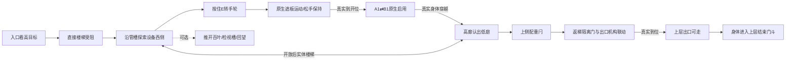

# C01-L01《侧向通行》M1-R1 体验修订

M1-R2保留本文件的空间与机关基线，只更新英语对白、双语设置与临时演出；当前15句台词及验证见[R2记录](../m1-r2-review.md)。下文R1声音数量、对白和对应测试属于该版本历史。

2026-10-17。用户亲自游玩 M1 后指出：关卡能够通关，但两次明显开关之间缺少探索、同行角色和设施反馈。本轮只修订 **C01-L01**，并建立它直接需要的栈雀挂载、事件对白、字幕与离线配音接口。它是灰盒体验迭代，未进入正式模型、美术或最终体验验收；未制作 S01、L02、L03。

当前可玩版本以本文件为准；[第一章原设计](chapter-01-awakening.md)和[M1 实施记录](../m1-c01-l01.md)保留设计与技术历史。[本轮验证记录](../m1-r1-review.md)、[栈雀设定](zanque.md)、[对白与 Windows 配音](../voice-production.md)分别记录证据、角色边界与制作方法。修订不改变澄湾站、林岑、衡务、许澈的主线，也不提前引入 L03 的自由放门。

## 本关要让玩家认识什么

高处出口和身体之间的障碍不是平面距离，而是可达关系。固定折口把侧面的低位检修口连接到同一庭院的高廊；通过之后，原来的设备、绕行线路和低庭能从另一高度重新认出。随后开放的实体楼梯是一条真正保留下来的路。

这仍是一堂简单的固定门教学。新增内容用来让玩家观察设施、对局部功能形成猜测、检验猜测并看到后果，不要求寻找更多钥匙或做复杂的设备联锁题。两处主机构之外的检视百叶是可忽略的探索，不是第三个通关按钮。玩家无需听完台词、看完字幕或走满指定回路。

## 相对 M1 的改变及原因

| M1 的局限 | 本轮改变 | 要验证的体验价值 |
| --- | --- | --- |
| 长地面导线直接把入口交给独立黄色开关 | 管槽沿设备南缘转向西侧，手轮贴设备侧部，保留局部操作标记 | 先看出口与旧楼梯，再沿真实设施关系发现检修操作 |
| E 一按遮板自动全开，缺少手上机械反馈 | 按住 E 转轮并提升遮板；松开时棘爪保持，可分段完成 | 玩家能观察自己持续操作和真实运动的联系，无长倒计时或精细节奏要求 |
| 设备是一整块不可探索的大障碍 | 拆为南北两座泵组，中间有可打开的横向检视槽、管线与表针 | 从侧面得到真实的新视角，并可横穿检查同一设备；不把所有探索都变成必经条件 |
| 上层整块实心栏板遮挡低庭回望 | 改成带真实碰撞的顶梁、踢脚与立柱 | 从常规落脚点和近栏观察位认出同一庭院；不是只在特定像素位置才能看见 |
| 上侧小开关只显示门开 | 上侧配重闩、线缆和配重表达返梯门/出口检修构件联动 | 行动对设施有可观察的后果，关卡开放后实体楼梯真正双向可走 |
| 全程独自操作，只有系统文字 | 肩侧折叠终端栈雀，少量由事件触发的短对白和字幕 | 有一个观察有限、会迟疑和记住现场的同行者，不替玩家解题 |

手轮和上侧配重闩依然是两处主要操作。判断修订是否有效，不能数新增物件和台词；要看它们之间是否发生了有趣的观察和认识变化。

## 空间布局与尺度

世界单位为米，X 向东、Z 向北、Y 向上。玩家点位用脚底坐标，折口/机构用中心。关卡仍在主庭 X[8,24]、Z[0,14.4] 内，低庭地坪0，高廊2.4，东侧只保留本关浅结束门斗。所有运动、穿越和碰撞沿用固定版 ArkGlide 原生能力。

```text
北 +Z                       Z14.4
    ┌───────────────────────────────────┐
    │ A1 后方实体面        北泵组       │ 高廊 ┌→结束门斗
Z10 │ [A1/遮板]     ┌─────────────┐     │      │ 出口
    │              │ 检视槽 →→→  │     │ B1←  │
Z8  │  手轮·百叶   └─────────────┘     ├──────┤
    │              南泵组              │实体梯│
    │       管槽绕设备转向             │      │
Z3  │ O1↗高目标                低侧隔离门      │
    └───────────────────────────────────┘
    X8       X13.35  X14.1     X19.9 X20.25 X24

剖面：低庭 0 ── A1 ──空间连接── B1 ── 高廊 2.4
                     真实返路：高廊 → 15级实体梯 → 低庭
```

示意不按字符比例；可走区域和遮挡以实体三维几何为准，不是另一关或后续章节的占位。

| 点位/结构 | 当前几何 | 玩家路线与视线目的 |
| --- | --- | --- |
| O1 测试入口 | 脚约(9.5,0,3)，眼约1.6；初始身体中心Y=0.92后物理落稳 | 初视线向东北偏上，高出口是首个目标；没有锁头演出 |
| 高目标 | 东墙出口中心(24.12,3.8,13)，上方对比门冠 | 从低处能看见，不能直接走到；完成区始终在上层门斗 |
| 直接楼梯 | X约20.25..24，Z3.2..8，15级，每级0.16高/0.32深 | 宽而真实的已有建筑，低侧门在Z2.75；上侧开闩前不能登梯 |
| 南泵组 | X14.1..19.9，Z4.3..8.2，高1.9 | 阻挡斜向直走，但不会遮住高出口门冠 |
| 北泵组 | 同X，Z10.5..13.7，高1.9 | 与南泵组构成有功能含义的横向检查通道 |
| 手轮 | (13.35,1.12,8)，侧向安装；推荐靠近脚位约(12.1,0,8) | 从设备西侧接近，面板和转动平面可辨；不再是入口正前方台柱按钮 |
| 检视百叶 | (14.03,1.0,9.35)，高1.8、沿Z宽1.9，向上移2.1 | 可选 E 打开，真实揭开泵组之间的检视槽；不触发出口解锁 |
| 检视槽 | Z8.2..10.5，门槛高0.12；内部有低管线及表针 | 可探看或穿行到设备另一面，展示线路转向；不能因此登上高廊 |
| A1 | (11,1.4,10)，正面朝-Z，孔径2.2×2.8 | 门前可后退、侧移、观察；遮板完全让开后才调用原生安装/启用 |
| B1 | (24,3.8,10)，正面朝-X，相同孔径 | 2.4高安全落脚，面朝旧庭院；不自动转视角去找出口 |
| 上层护栏 | 西边界约X20.1，栏顶离高廊约1.3；真实顶梁、踢脚和立柱 | 留下观察开口；仍以真实碰撞防跌落和侧跳 |
| 上层观察位 | 脚约(20.7,2.4,11.6)，朝O1、设备侧线路与低侧梯门 | 可把门中见过的视图与真实低庭对照；此点是推荐观察位置，不是隐藏触发器 |
| 配重闩 | (21,3.45,10)，与B1面相距3 | 不应在A1前以1.8米跨门交互距离远程开启；能看见线缆和低处门的变化 |
| 实体返回路 | 高廊南端→原楼梯→Z2.75低门→低庭 | 开放后双向；回低庭及再上楼均自主，不检查“必须走完一圈”的胜利旗标 |

检视槽东端会接触高廊下方的低位空间。其探索用途是看到同一设备的另一侧，不是隐藏的上层捷径；净空、折返辨认和不会被楼梯末端困住是本轮必须检查的风险。不能靠不可见碰撞封住一条看似能走的开口。

## 机关与状态关系



主状态只向开放推进，不重复反锁。手轮不足全程时保持当前进度，继续靠近按住即可；不要求一次按到底。遮板达到实际开位后才放置并连接原生固定门，不提前穿过挡板激活。配重闩到位前返回路仍未宣布开放；完成只认开放状态和玩家身体实际进入上层门斗。不会因站在下层出口投影、听完一句话或按过手柄直接通关。

机械反馈包括手轮辐条、表针、移动遮板、百叶把手、配重与门的变化，辅以四个原创短机械 WAV。它们的缺失或播放失败不阻碍机关。栈雀不操纵机关，衡务不会用广播取代可观察的状态。

出口机构在原生移动门板前增加四根随动检修框/撑条，让“收回检修构件”的后果在场景上可见。检视槽顶部采用南北两根细梁，保留观察设备截面的视线；不把一块宽实心盖板称作开放检查口。手轮立柱顶降至0.88米，让中心交互射线能实际命中手轮，避免装饰支撑挡住操作。

| 观察/事件 | 运行触发条件 | 不能据此声称的事情 |
| --- | --- | --- |
| 进入巡检庭 | 解锁控制后的第一次实际模拟更新 | 不代表S01已经演出或玩家已接受此前教学 |
| 首看高出口 | 尚未跨门、身体仍低处；视向点积超过0.93，原生物理射线先命中出口，累计超过0.6秒 | 不证明玩家已经理解该如何抵达 |
| 直接路受阻 | 返路未开时接近低侧梯门范围 | 不证明玩家仔细观察了上端联杆 |
| 检视设备 | 百叶实际运动进度达到0.999后，仅发一次 | 不宣称玩家已经进入槽道或读懂所有线路 |
| 固定折口就绪 | 遮板真实到位，原生安装成功、相互连接并启用 | 不能以操作手轮或启动声音替代门真正可用 |
| 首次穿越 | 玩家原生 `onTraverse` 从A1穿出 | 不把触发区域或手动坐标变化当穿门 |
| 返路开放 | 原生梯门和出口机构实际到开位 | 不要求玩家为完成状态再跑一圈 |
| 回低庭 | 返路开放后身体回到低侧梯口范围 | 不用不可见检查强制作者指定返程走法 |
| 本关完成 | 开放后身体实际进入上层门斗 | 不等于真人体验或正式质量验收 |

## 探索与替代行为

- 可以先检查楼梯，也可以直接沿设备侧发现手轮。漏过楼梯对白不损害解法。
- 可以忽略百叶完成本关；打开后得到设备截面、真实横向通路与独有短观察，而不是钥匙、奖励分数或结局条件。
- 可以把遮板转开一半，松手看机械位置，再继续；保持进度不能变成误触后定时归零的繁琐重试。
- 可以在门前只观察另一侧、后退、从侧面靠近、反复双向穿越；固定折口规则一致，不按“教程步骤”自动关门。
- 开闩后可以直接走出口，也可以沿楼梯回到低庭、原路再上、重新穿门。回低庭有一次路线观察，不要求为听台词跑回去。
- 可以关闭语音和字幕继续操作；所有必要目标、阻挡和开放后果必须由场景独立表达。

## 栈雀、对白与本轮入口

栈雀是原创的小型折叠维修辅助终端，采用肩侧挂载，具有主体、双条矩形状态灯、工具翼和支架。待机、观察、说话反馈不同；没有影响玩家移动的物理体。本轮画面迭代将原型各部件同比缩至0.82，保持挂载中心和近门收折关系，减小右下占屏。近折口收折，随当前原生相机的映射位姿恢复肩侧关系，不追赶跨空间的玩家坐标，也不控制玩家或相机。

实际看图曾发现设备与近处护栏相交；因此增加从当前眼位向预期展开挂载点的原生物理射线，在墙/栏杆挡住肩侧空间时使用同一套局部收折。检测始终查询预期展开位置，而不是已经收折的位置，避免同一障碍造成来回展开。它不推动玩家、不改变相机、不生成NPC碰撞体；复杂边缘、快速转身和不同屏幕比例仍需真人检查。

未来首次获得可放入 S01；本轮安全测试入口直接携带已经配对的栈雀。不能把这一初始化称作已完成的正式入场剧情。

对白覆盖进入巡检庭、看高出口、发现直接路受阻、检视设备、门启用、首次原生穿越、返回路到位、自选返程与终点。11句共用一个串行队列，有优先级、过期、后续事件取消和句间留白，不让两个角色抢说。角色、ID、字幕、资源及触发配置见[对白表](../voice-production.md)。栈雀的误猜只涉及用途，不给错误操作指令；衡务仅做短状态确认。

**本轮实际 WinTTS 配音为0/11，不能称为已完成配音。** 当前可体验事件字幕、伴随实体和机械音效；Windows 本地生成与替换方法见[配音制作](../voice-production.md)。V 关闭/打开语音，B 独立关闭/打开字幕。实际有声表演、两角声音区别和完整音画感受要在合法生成真实语音后再试听验收。

## 首次体验设计推演

以下是设计推演，不是真人测试结果。

玩家先看见高出口和肩侧终端，知道要去上面，但仍不知道怎么去。若先走向宽楼梯，近处隔离门和上行连杆应让其认为“这条路存在，但现在不能从下面开”，而不是怀疑碰撞坏了。管槽朝设备侧绕行，成为探索另一个工作点的理由。

来到设备西侧，玩家可能先按 E 试手轮，看到遮板只抬起一段；进度保持和辐条运动应让其愿意继续按住，而不是误以为卡住。也可能先打开邻近百叶，发现它露出一条可看的真通道。可选支路不能把高目标彻底藏出记忆，也不能以字幕宣布必须进去。

遮板升起，门中有另一高度的护栏和庭院。玩家可能试图绕过框体，可能退后确认，再决定走入。通过之后，朝西的落脚方向让原来的设备先进入视线；透空栏和不同高度提供“我没有换到另一间复制房间”的认识。栈雀记住同一条绕行线，但不替玩家解释全部空间关系。

配重闩沿实体线缆牵动旧梯门和出口机构。玩家能够从上侧看到先前受阻的路确实开放。想确认的玩家走下去，得到一个简短的共同观察，再用实体路返回；只想继续的玩家走出口，也不会因没参观而被挡。

最可能的误读是：只点击手轮便离开；把可选槽当主路；认为栈雀说话时必须等；高廊下方看起来像隐藏出口；从B1出门后没认出同一低庭。这些问题必须用真实初见反馈判断，允许再改布局或删减支路，不能用追加台词解释过去。

## 失败、暂停、重试与存档合同

按R通过原生初始快照回到本关安全入口，回溯遮板、门对、梯门、出口、百叶和一次性叙事旗标。重试停止正在播放的声音，清除旧队列，保持玩家对语音/字幕的选择。重新开始可以再次体验新时间线；同一时间线内路过触发区、来回穿门不重播同一事件。

暂停冻结角色活动、机关、字幕时间与原生音频句柄；恢复继续。销毁释放栈雀的mesh/材质、当前语音及反馈句柄，原生owner清理其余相机、折口、运动、监听和provider。局部读档保留已消费事件，避免从头补播一整段对话；它不承诺实现整章持久存档UI。

本关没有可搬核心物件和耗材，不以物件回收/刷出副本解决软锁。遇到边缘碰撞、直接爬高或穿模，先改真实结构和受支持的参数；不写L01专用假传送或隐藏胜利检查否认合法抵达。

## 人工验收仍需回答

1. 第一眼是否识别高出口；玩家首先尝试的路线是否合理？
2. 侧部手轮和按住操作是否自然可知；松手保持是否清楚？
3. 检视槽有无独立观察价值，是否造成不必要迷路？
4. 门前能否预想另一侧，从B1出来能否认出原来的庭院？
5. 上侧配重联动是否一眼可读；实体返路是否值得自主走一遍？
6. 栈雀占屏、运动、近门收折是否舒适；有无遮挡目标或廉价漂浮感？
7. 短对白像同伴观察还是任务播报；静音/无字幕是否仍能理解？
8. 这次迭代是否解决“技术演示过薄”，而非只增加装饰和文字？

技术结果和截图只见[本轮记录](../m1-r1-review.md)。用户未试玩新版前，保持“待人工验收”；提交推送后停止，不进入下一关或正式美术。

本轮同环境软件渲染对比已测得入口约15%、门前约10%的帧率下降，不能宣称新增内容没有性能影响。虽然云端SwiftShader绝对帧率不能代表Windows GPU，目标设备性能与舒适度仍是下一次人工验收问题；详见本轮记录的样本方法及限制。
