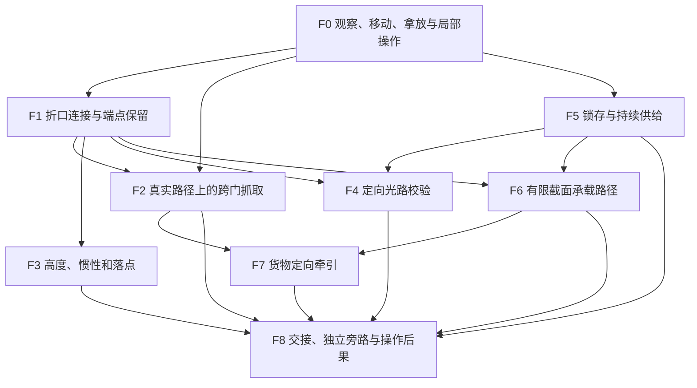

# 机制递进：连接路径，而非堆叠装置

M0 提案。F 编号是机制/认识，M 编号才是开发里程碑。六个教学阶段可以在一个单元内连续发生，也可以跨章节；不能为了填表而再造六个相似房间。

## 核心机制与先修图

图表示必要认知，不表示新 API 必须依赖另一 API。F8 是整体认识，不是终章突然发放的新武器。

## 六步教学表

| 机制 | 引入 | 理解 | 运用 | 变化 | 组合 | 挑战 |
| --- | --- | --- | --- | --- | --- | --- |
| F0 基础交互 | C01-S01 在可见托盘旁拿开滤盒 | 同段对照手轮、表针、门的即时反馈 | C01-L01 操作遮板与回路梯闩 | C01-S02 从物理变化区分“已操作/已到位” | 贯穿后续空间，不靠新增按键制造难度 | C09 用同样输入交接，不考新手速 |
| F1 折口空间 | C01-L01 固定两端，先看清高处目标 | C01-L02 窄口只能送物，孔径仍真实 | C01-L03 自己放置两端，观察位与出发位分离 | C02-L03 看着近却不是可搬运的路径 | C03-L04 同井多程；C04 光路改向；C06 承载 | C08-L02 与 C09-L01 在一对端点内完成多路交接 |
| F2 跨门抓取 | C01-L02 由普通拿放迁移到可见折线路径 | C02-L01 直视玻璃与侧向可达的区别 | C02-L02 不取回，反而要放到远侧保持 | C02-L03 有效距离、转角与实际障碍 | C05-L02 先建退路再回收；C07-L04 人货分流 | C08-L04 收回临时件；C09-L02 交接仍不切断人行 |
| F3 动量/落点 | C03-L01 低落差先试送物件 | 同关宽落区的身体换向，建立安全预期 | C03-L02 选择合适高度，过高反而越过目标 | C03-L03 物体终点与人的终点不同 | C03-L04 同井两程，以端点与落台重组已走空间 | C09-L01 的受控投递使用已掌握落点，不引入极限跳跃 |
| F4 光路校验 | C04-L01 无伤害光斑和单反射面 | 同关从接收面方向确认因果 | C04-L02 用跨门观察解决调节/读数分离 | C04-L03 先锁机械，再移交同一束光 | C04-L04 遮断与联锁；C05-L03 核查真实状态 | C08-L03 / C09-L03 共管方案的就地验证 |
| F5 供给/锁存 | C01-L02 机械棘爪保持成功 | C02-L02 安全托台上学保持式与锁存式的差别 | C02-L04 建备用路再取唯一匣 | C04-L03 改变供给对象而保留机械成果 | C05-L02 与人行安全相连；C06 投射承载 | C08-L04 逆序安全撤除；C09 按方案明确资源去向 |
| F6 承载投射 | C06-L01 从实体地面看截面生成 | C06-L02 侧边障碍也会截断真实宽度 | C06-L03 到实心落台后换路 | C06-L04 一条临时路两次服务不同任务 | C07-L04 货路占门，人走备用路 | C08-L02 / C09-L03 在保持必要路径时回收临时连接 |
| F7 定向货流 | C07-L01 安全停货器前观察推动 | 同关认识只推货、不推人和停靠边界 | C07-L02 稳态下反向/重定向一段 | C07-L03 出口段的方向随空间映射 | C07-L04 与承载、人行、供给交接 | C08-L04 / C09-L03 主线方案撤临时流路并留安全出口 |
| F8 设施后果与交接 | C01 自己接通，远处卷闸封闭 | C04 校验显示登记对象错误 | C05 回访并修正同一封闭线 | C06–07 人能走与货能走分离 | C08 独立回路支持三方案，无时压试示 | C09 亲手提交知情方案，走过对应终态 |

F2 不是只演示一次“隔门吸箱子”：它依次涉及视线与可达性、把物品留在对岸、有效路径、换路次序、货人分离和安全回收。F3 的深化来自落点目的与路线角色变化，不靠把每次跳跃拉得更远。

## 章节发展矩阵

符号：I 引入；D 深化/迁移；C 组合；R 复用并改变意义；— 不要求。不能把表中空格自动变成待实现内容。

| 机制 | C01 | C02 | C03 | C04 | C05 | C06 | C07 | C08 | C09 |
| --- | --- | --- | --- | --- | --- | --- | --- | --- | --- |
| F1 | I/D | D | C | C | R | C | C | C | R |
| F2 | I | D | C | — | R | C | C | C | R |
| F3 | — | — | I/D/C | — | — | — | — | — | R |
| F4 | — | — | — | I/D/C | R | — | — | C | R |
| F5 | I | D | C | C | R | C | C | C | R |
| F6 | — | — | — | — | — | I/D | C | C | R |
| F7 | — | — | — | — | — | — | I/D/C | C | R |
| F8 | 伏笔 | 伏笔 | 观察 | 核查 | 回访 | 应用 | 应用 | 综合 | 决定 |

F3 中段不强行出场，避免每种能力每章都塞一次；C09 复用前的路线会提供可选低风险试送，让久未使用的知识重新进入注意力。若试玩表明遗忘严重，应重排或削减该终章要求，不在高潮用字幕补课。

## 每次组合必须产生的新问题

| 组合 | 推理问题 | 明确排除的填充方式 |
| --- | --- | --- |
| 折口 + 抓取 | 身体、物体、视线能走的路径是否相同？ | 多摆两个同样的匣子 |
| 抓取 + 保持供给 | 把匣子取走后，我和别人还能离开吗？ | 反复跑回入口搬同规格道具 |
| 折口 + 动量 | 我需要落到哪里、以什么速度，而不是能飞多远？ | 越来越窄的落点、突然要求极限操作 |
| 折口 + 光路 | 调节端与观测端能否同时获得足够信息？ | 更多镜子但没有新的观察关系 |
| 折口 + 承载 | 当前使用的路是否允许我改变它的端点？ | 无落脚点地强迫快速重放门 |
| 货流 + 人行 | 货到了不等于人到了；哪条路要先保留？ | 让玩家等多轮自动运输凑时间 |
| 多路交接 | 哪个临时依赖应先解除，才能留下可接手的终态？ | 总开关一次解锁全部结果 |

## 教学可见性和提示

- 新规则第一次出现时目标稳定、失败代价低、相关物体尽量同框；不同时加入新输入、新逻辑和时间压力。
- 第一章固定折口给的是空间认知，自主放置留到 L03；L02 的跨门拿放建立在 S01 的普通拿放上。
- 必需线索不只靠颜色、字幕或声音：锚面的折线压纹、设备运动方向、管线走向和反馈轮廓共同表达。
- 提示优先定位卡点：未见目标→整理视线；误读规则→提供可观察反例；忘记先修→安全情境唤回；已知解法但操作失败→修碰撞/容差。
- 第一层提示只突出对象，第二层提示关系，最后才提供用户主动请求的明确步骤。时间阈值只是可调的提示候选条件，不把慢解直接判为失败。
- 每次真实盲测记录“首次看到目标、第一次有效尝试、误读、顿悟表述、重试、旁路”，不只记录最快通关。

## 待人工审查的机制取舍

承载投射与货流虽有接口，但是否都值得成为主线机制，需以先前关卡的实测学习负荷和独特性判断；可以缩减、延后或删除。不得为覆盖引擎 API 而保留无价值关卡。后续单元若依赖新增未验证机制，先回到设计与技术门，不借路线图默认获批。
